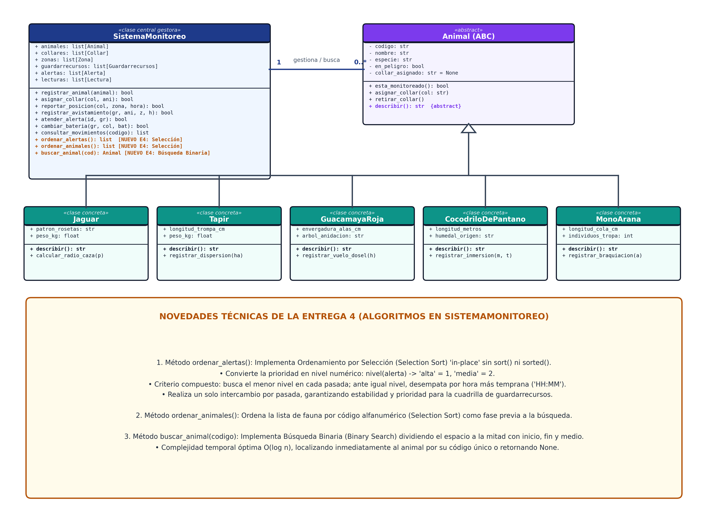
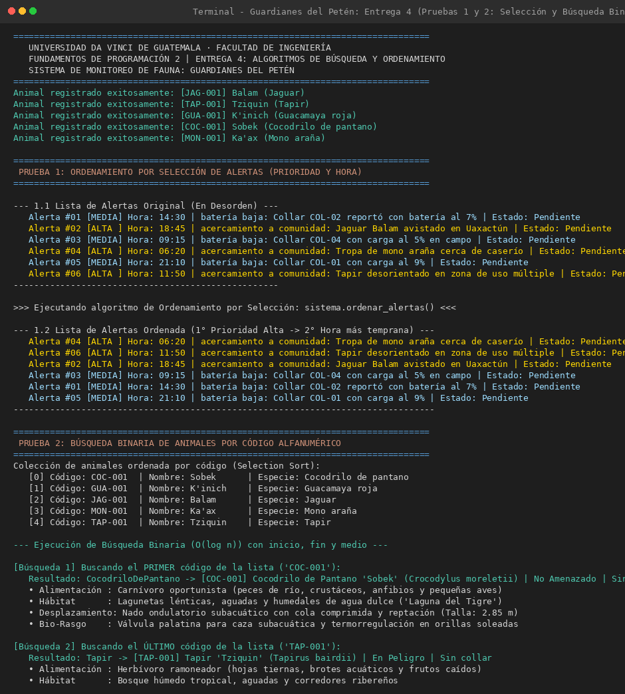
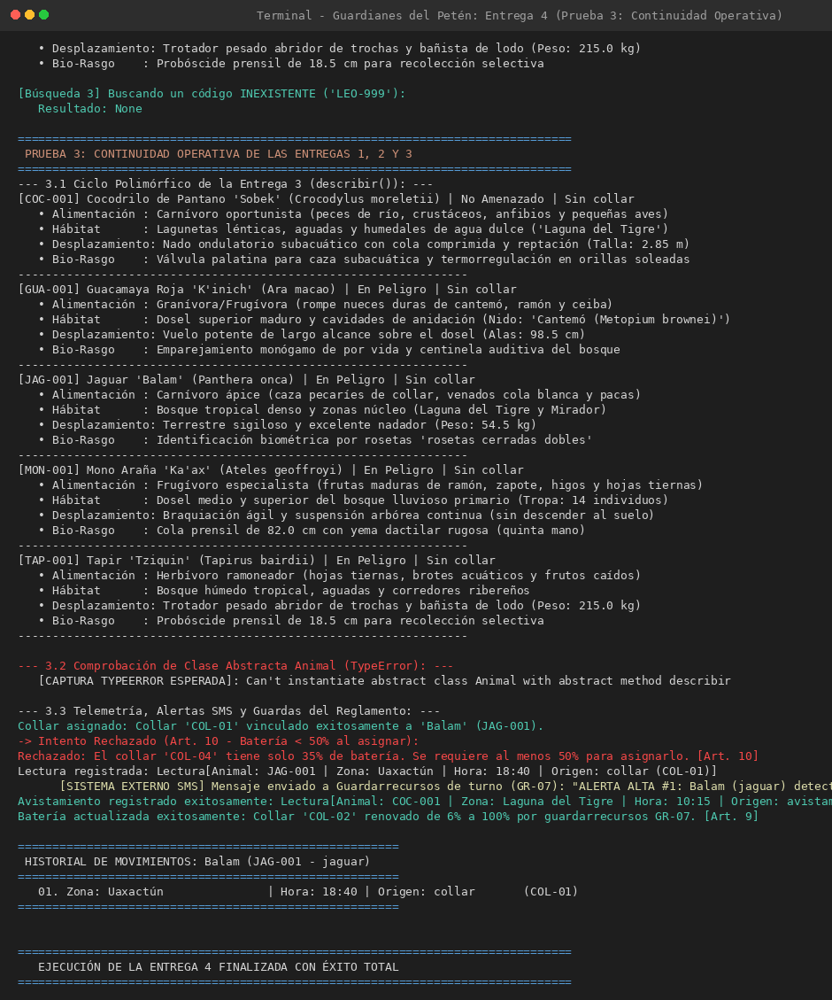

# Guardianes del Petén — Sistema de Monitoreo de Fauna
### Reserva de la Biosfera Maya · Universidad Da Vinci de Guatemala
**Facultad de Ingeniería · Fundamentos de Programación 2**

---

## 📌 Datos Generales de la Entrega

| Campo | Detalle |
| :--- | :--- |
| **Estudiante** | [Nombre Completo del Estudiante] |
| **Carné Universitario** | [Número de Carné] |
| **Curso** | Fundamentos de Programación 2 |
| **Grupo / Sección** | Sección A |
| **Entrega** | **Entrega 4 — Ordenar las alertas y buscar animales (Selección y Búsqueda Binaria)** |
| **Fecha** | Noviembre de 2026 |
| **Repositorio Oficial** | `https://github.com/[tu-usuario]/guardianes-del-peten` *(Público)* |

---

## 📖 Descripción General del Sistema

El proyecto **Guardianes del Petén** es una solución integral orientada a objetos para la gestión de telemetría, conservación y respuesta operativa ante eventos críticos de fauna en la Reserva de la Biosfera Maya (Petén, Guatemala).

En esta **Entrega 4**, el sistema incorpora dos capacidades algorítmicas esenciales desarrolladas desde cero sin utilizar bibliotecas o métodos integrados (`sort()`, `sorted()`, `bisect`):
1. **Ordenamiento de Alertas por Selección (*Selection Sort*):** Prioriza la atención de eventos críticos colocando primero las alertas de prioridad **alta** y luego las de prioridad **media**; ante alertas con el mismo nivel de prioridad, las ordena cronológicamente por su **hora más temprana** de reporte.
2. **Búsqueda Binaria de Animales por Código (*Binary Search*):** Permite al personal de campo y biólogos localizar instantáneamente la ficha biológica completa de un espécimen en tiempo logarítmico $\mathcal{O}(\log n)$, buscando sobre la colección previamente ordenada por código alfanumérico.

---

## 📐 1. Diagrama de Clases UML Actualizado

El diagrama modela la arquitectura completa del sistema, destacando la clase central `SistemaMonitoreo` con sus dos nuevos métodos algorítmicos (`ordenar_alertas()`, `buscar_animal()`), asociada a la jerarquía de herencia polimórfica encabezada por la clase abstracta `Animal` y sus cinco clases hijas especializadas.



### Métodos Clave Incorporados en `SistemaMonitoreo`:
* `+ ordenar_alertas(): list[Alerta]`: Ordenamiento por selección in-place sobre la lista de alertas con criterio compuesto (prioridad y hora). Exactamente un intercambio por pasada.
* `+ ordenar_animales(): list[Animal]`: Ordenamiento por selección alfanumérico por código de animal (`codigo`), preparando la lista para la búsqueda binaria.
* `+ buscar_animal(codigo: str): Animal | None`: Algoritmo de búsqueda binaria con punteros `inicio`, `fin` y `medio`. Devuelve la referencia al objeto o `None`.

---

## ⚙️ 2. Fundamentos Algorítmicos

### 2.1 Ordenamiento por Selección de Alertas (`ordenar_alertas`)
Para responder de forma inmediata a emergencias territoriales (como la incursión de jaguares en comunidades humanas bajo el Artículo 6), las alertas se ordenan utilizando una función de mapeo numérico de prioridad:
```python
def nivel(alerta):
    if alerta.prioridad.lower() == "alta":
        return 1
    return 2
```
* **Criterio de ordenamiento:** En cada iteración $i$, se busca la alerta con menor `nivel(alerta)`. Si dos alertas empatan en nivel, se desempata evaluando la cadena cronológica `alerta.hora` en formato militar `"HH:MM"`.
* **Intercambio único:** Una vez identificado el índice del mínimo de los elementos restantes, se realiza un solo intercambio `swap` con la posición $i$, garantizando estabilidad algorítmica.

### 2.2 Búsqueda Binaria de Animales (`buscar_animal`)
Permite consultar especímenes por código (`COC-001`, `GUA-001`, `JAG-001`, `MON-001`, `TAP-001`) partiendo el espacio a la mitad en cada ciclo:
```python
inicio = 0
fin = len(self.animales) - 1

while inicio <= fin:
    medio = (inicio + fin) // 2
    if self.animales[medio].codigo == codigo:
        return self.animales[medio]
    elif codigo < self.animales[medio].codigo:
        fin = medio - 1
    else:
        inicio = medio + 1

return None
```
* **Complejidad:** Reduce las comparaciones de $\mathcal{O}(n)$ a $\mathcal{O}(\log n)$, eliminando la necesidad de recorrer secuencialmente el inventario completo.

---

## 📂 3. Estructura Modular del Proyecto

Cada clase reside en su propio archivo independiente dentro del repositorio:

```text
guardianes-del-peten/
│
├── animal.py                # Clase abstracta base Animal (ABC) con método abstracto describir()
├── jaguar.py                # Clase concreta Jaguar (Panthera onca)
├── tapir.py                 # Clase concreta Tapir (Tapirus bairdii)
├── guacamaya_roja.py        # Clase concreta GuacamayaRoja (Ara macao)
├── cocodrilo_de_pantano.py  # Clase concreta CocodriloDePantano (Crocodylus moreletii)
├── mono_arana.py            # Clase concreta MonoArana (Ateles geoffroyi) - Especie propia
├── collar.py                # Clase Collar GPS de telemetría
├── zona.py                  # Clase Zona territorial (núcleo, amortiguamiento, uso múltiple)
├── guardarrecursos.py       # Clase Guardarrecursos oficial
├── lectura.py               # Clase Lectura de movimiento o avistamiento
├── alerta.py                # Clase Alerta (con prioridad, detalle y atributo hora)
├── servicio_sms.py          # Simulador de despacho de mensajería SMS a guardarrecursos
├── sistema_monitoreo.py     # Clase central: guardas, Selection Sort y Binary Search
├── main.py                  # Programa principal de pruebas y evidencias
├── diagrama_clases_e4.png   # Diagrama de Clases UML oficial actualizado
├── captura_e4_pruebas.png   # Evidencia de terminal de las Pruebas 1 y 2
├── captura_e4_operatividad.png # Evidencia de terminal de la Prueba 3
└── README.md                # Documentación oficial del repositorio
```

---

## 🖥️ 4. Evidencia de Ejecución de `main.py`

### 4.1 Evidencia de Pruebas 1 y 2: Ordenamiento y Búsqueda Binaria
Demostración de:
1. Lista de alertas original en desorden con prioridades altas/medias y horas heterogéneas.
2. Lista de alertas ordenada correctamente (Prioridades altas primero ordenadas por hora, seguidas de prioridades medias ordenadas por hora).
3. Búsqueda binaria exitosa del **primer código** (`COC-001`), del **último código** (`TAP-001`) y de un código **inexistente** (`LEO-999` devolviendo `None`).



### 4.2 Evidencia de Prueba 3: Continuidad Operativa (Entregas 1, 2 y 3)
Demostración de:
1. Ciclo polimórfico recorriendo todas las especies sin `if` ni `isinstance`.
2. Captura del `TypeError` al intentar instanciar directamente la clase abstracta `Animal`.
3. Telemetría GPS con alertas SMS a guardarrecursos en Uaxactún (Art. 6), avistamientos, atención de alertas (Art. 8), cambio de batería (Art. 9) y guardas del reglamento.



---

## 🚀 5. Instrucciones de Ejecución

Para clonar y ejecutar el sistema en cualquier entorno con Python 3 instalado:

```bash
# 1. Clonar el repositorio público
git clone https://github.com/[tu-usuario]/guardianes-del-peten.git

# 2. Entrar al directorio
cd guardianes-del-peten

# 3. Ejecutar el programa principal
python3 main.py
```
